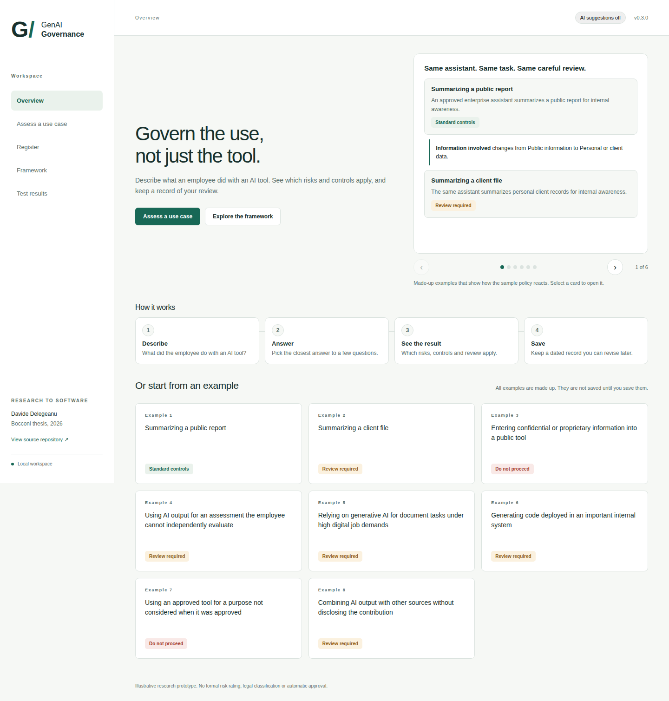
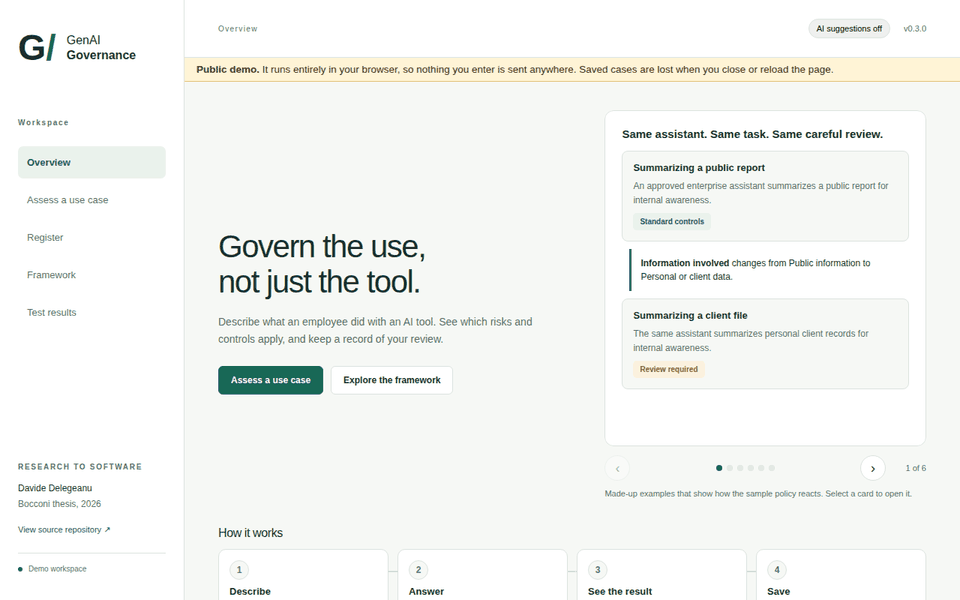
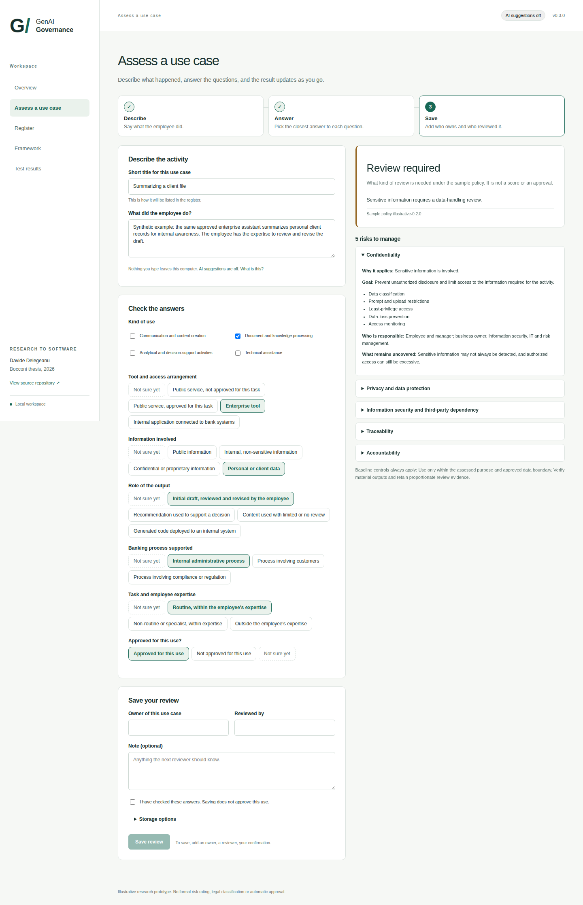
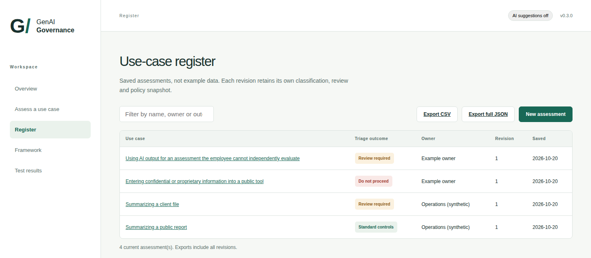
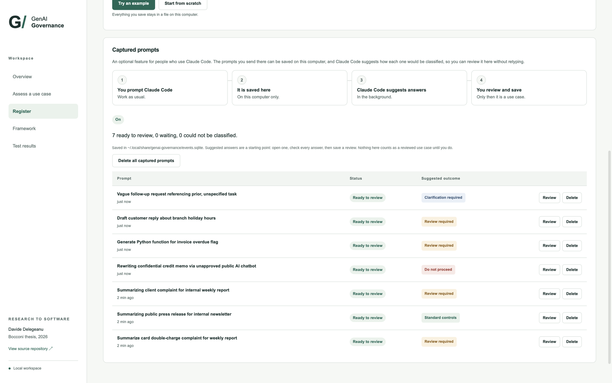

# GenAI Bank Governance

[](https://github.com/davidedele/genai-bank-governance/actions/workflows/tests.yml)
[](https://davidedele.github.io/genai-bank-governance/)


**How should a bank review what employees actually do with generative AI, and not only which tools it approves?**

I looked at this question in my bachelor's thesis at Bocconi, *The Use of Generative Artificial Intelligence in Banks: Governance, Risks, and Internal Controls* (2026). Once the research was done, I wanted to see what the framework would feel like as a working tool. This repository is that experiment.

You describe what an employee did with an AI tool, answer a few questions about it, and the app shows which risks and controls apply and what kind of review is needed. You can then save the review. A language model can suggest the answers if you turn that on, but it never decides the outcome. A separate, readable set of rules does.

It is a research prototype with made-up examples. It is not a compliance product and it is not meant for real customer information.



## What this shows

**The problem.** A bank can approve an AI tool and still face very different risks, because the risk depends on what an employee does with it. The same assistant summarizing a public report and summarizing a client file need different care.

**What the register does.** It turns a description of a real use into the risks, controls and kind of review that apply, using readable rules that a person can check, and it keeps a dated record of every review.

**What the benchmark measured.** Nothing about real banks yet. It is a set of 64 made-up descriptions with the answers I expect, built to test how often an AI suggestion agrees with them. I have not published a result, and the page says so.

## Run it

You need Python 3.10 or newer. Everything except the optional AI suggestions works without an API key or an internet connection.

In a terminal, from the repository folder:

```bash
python3 -m venv .venv
source .venv/bin/activate
python -m pip install -r requirements.txt
python app.py
```

Then open **http://127.0.0.1:8501**. Press `Ctrl+C` in the terminal to stop it. On Windows, activate the environment with `.venv\Scripts\activate`.

## Try it online

**[Open the live demo](https://davidedele.github.io/genai-bank-governance/)**. It needs no account and no installation.

The demo is the real app, not a mock-up. The Python code runs inside your browser through [Pyodide](https://pyodide.org), so nothing you type is sent to a server, and the saved cases are lost when you close or reload the page. The overview opens at once. Answering, saving and exporting start when the Python runtime has been downloaded to your browser, which takes up to half a minute on the first visit. The runtime is a checked copy of Pyodide served from the same site, so the page does not contact any other server. The AI suggestions and the Claude Code capture are switched off in it. Use made-up information only.



GitHub rebuilds the demo every time I push to `main` (see `.github/workflows/pages.yml`). To publish your own copy of it, fork the repository, open **Settings**, then **Pages**, and set **Source** to **GitHub Actions**.

## What you can do

1. Start from an empty use case or from one of the made-up examples.
2. Describe the activity and answer the questions: the kind of use, the tool, the information involved, how the output is used, the banking process, the employee's expertise, and whether this use is approved.
3. Watch the result on the right update as you answer. It lists the risks, the controls, who is responsible, and why each rule applied.
4. Save your review with an owner, a reviewer and an optional note.
5. Come back later and save a new revision. Earlier reviews are never overwritten.
6. Export everything as JSON or as a CSV summary.

The questions follow the five dimensions from my thesis: tool and access, information, role of the output, banking process, and task and expertise. The approval question, the "not sure yet" answers, the outcome rules and the revision history are my additions in the software, not findings of the thesis.



## What the outcomes mean

The rules live in [`data/policy.json`](data/policy.json). An outcome says what kind of review is needed under those sample rules. It is not a risk score and it is not an approval.

| Outcome | Meaning |
|---|---|
| Standard controls | Nothing extra is triggered. The baseline controls still apply. |
| Clarification required | Some answers are missing. |
| Review required | At least one rule calls for a review. |
| Do not proceed | A stop rule applies, for example sensitive information in a tool not approved for it. The app only recommends this and does not block anything. |

Each saved review keeps the policy version and the reasons behind its result, so changing the policy later does not rewrite old records.



## Optional: AI suggestions

If you would like a model to suggest the answers from your description, install the extra dependencies:

```bash
python -m pip install -r requirements-llm.txt
```

Then copy `.env.example` to `.env` (only if you do not have a `.env` yet) and fill in four things: turn the feature on, pick a provider, pick a model, and add that provider's API key. For example:

```dotenv
ENABLE_LIVE_CLASSIFICATION=1
LLM_PROVIDER=openai
LLM_MODEL=the-model-name-from-your-provider-account
OPENAI_API_KEY=your-key
```

`LLM_PROVIDER` can be `openai`, `anthropic`, `gemini` or `grok`. There is no default model, because model names change often and depend on your account. Use one your provider lists. Restart the app after editing `.env`.

With this on, the header shows "AI suggestions on" and the assessment page names the provider and model. Nothing is sent until you tick the confirmation box and press the button. Please do not send real client information.

A suggestion can be wrong even when it is well formed, so check every answer before saving.

### Daily limit

To guard against running up charges by accident, the app allows 30 AI suggestions per day (UTC). I picked 30 as a round number that is plenty for trying it out. It is not a cost cap and it does not limit manual assessments. Change it in `.env`:

```dotenv
DAILY_CLASSIFICATION_LIMIT=30
```

Use `0` for no limit. One suggestion can involve up to three requests to the provider if the first ones fail, so check your provider's pricing. Each request times out after 25 seconds. More detail is in the [architecture notes](docs/ARCHITECTURE.md).

## What I tested, and what I did not

There are more than 150 automated tests covering the rules, the API, the saved revisions, the exports, the optional capture and the demo build. One of them walks through all 1,440 valid combinations of answers to check that the rules behave consistently. That is a check on the rules, not an evaluation of any model.

There is also a set of 64 made-up descriptions covering 24 scenarios, for comparing model suggestions with the expected answers. I wrote the labels myself and no bank professional has reviewed them, so I do not claim any accuracy for a live model or any effect in a real bank.

To run the checks without contacting a provider:

```bash
python -m pip install -r requirements-dev.txt
python -m pytest -q
python -m eval.run_eval --validate-only
```

To run the billable model evaluation, after configuring a provider and model:

```bash
python -m eval.run_eval --live --split holdout --output eval/results/holdout-run-01.json
```

More in the [verification record](docs/VERIFICATION.md), the [dataset card](docs/DATASET_CARD.md) and the [policy table](docs/POLICY.md).

## Privacy and limits

Run it on your own computer, with made-up or properly authorized data. The online demo is meant for made-up information only. Records go into a local SQLite file. The description text and model excerpts are not stored unless you choose to keep them, but names, owners, reviewers and notes always are, so keep sensitive details out of those too.

There is no login, no encryption of the saved file and no tamper-proof history, and nothing here replaces a real approval process. See [privacy notes](docs/PRIVACY.md).

There is also an optional plugin for Claude Code. It is off by default. When switched on, it saves the prompts you send in Claude Code to a file on your computer, and Claude Code suggests how to classify them so you can review them in the Register without retyping. It cannot block a prompt. If you installed an earlier version of that plugin, disable it first. See [the plugin guide](docs/PLUGIN.md).

## Optional: capture prompts from Claude Code

If you use Claude Code, you can have the prompts you send there show up in the Register as **Captured prompts**, with suggested answers from Claude Code itself, so no API key is involved. You still check each one and save the review yourself. It is off until you add one line to your Claude Code settings. The guide explains what is saved, where, and how to delete it: [docs/PLUGIN.md](docs/PLUGIN.md). The same explanation is in the Register page of the app.



## How it is built

The backend is Python with FastAPI, and the interface is plain HTML, CSS and JavaScript with no build step. Reviews are stored in SQLite, the rules are in `data/policy.json`, and the tests use pytest. The way the thesis maps to the code is in [RESEARCH_MAPPING.md](docs/RESEARCH_MAPPING.md), and [DEMO.md](docs/DEMO.md) is a short walkthrough.

## Reference

Delegeanu, D. (2026). *The Use of Generative Artificial Intelligence in Banks: Governance, Risks, and Internal Controls*. Bocconi University. The thesis is a literature-based analysis, not a validation against real bank data. Nothing here claims compliance with the AI Act, GDPR, DORA or any other regulation, and the controls and rules are illustrative.

## Copyright

Copyright © 2026 Davide Delegeanu. All rights reserved.

This repository is public so it can be read, but it is not open source. No licence is granted to copy, modify, redistribute or use the code commercially without my written permission, apart from what the law and GitHub's Terms of Service allow, such as viewing and forking on GitHub. If you would like to use or build on it, please get in touch.
