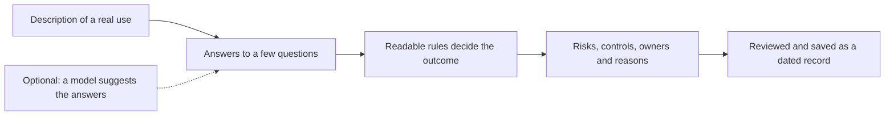
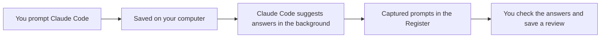

# GenAI Bank Governance

[](https://github.com/davidedele/genai-bank-governance/actions/workflows/tests.yml)
[](https://davidedele.github.io/genai-bank-governance/)


**How should a bank review what employees actually do with generative AI, and not only which tools it approves?**

This is a working answer to that question, built from my bachelor's thesis at Bocconi, *The Use of Generative Artificial Intelligence in Banks: Governance, Risks, and Internal Controls* (2026). You describe what an employee did with an AI tool, and the app shows which risks and controls apply, what kind of review is needed, and exactly why. Then you save the review as a dated record that is never overwritten.

**[Open the live demo](https://davidedele.github.io/genai-bank-governance/)**. It runs in your browser, needs no account and sends nothing anywhere.

[Idea](#the-idea-in-one-minute) · [Claude Code plugin](#the-claude-code-plugin) · [Run it](#run-it) · [What is verified](#what-i-tested-and-what-i-did-not) · [Engineering](#engineering-you-can-check)


| At a glance | |
|---|---|
| **4** outcomes, from standard controls to do not proceed | **9** risk areas, each with controls, owners and what stays uncovered |
| **1,440** combinations of answers checked for consistent rules | **64** made-up descriptions in a benchmark for AI suggestions |
| **200+** automated tests, on Python 3.10 and 3.12 | **0** third party requests made by the online demo |

It is a research prototype with made-up examples. It is not a compliance product and it is not meant for real customer information.

## The idea in one minute

**The problem.** A bank can approve an AI tool and still face very different risks, because the risk depends on what an employee does with it. The same assistant summarizing a public report and summarizing a client file needs very different care. A list of approved tools cannot see that difference.

**The answer.** Describe the use instead of the tool. A few questions about it, built on the five dimensions from the thesis (the tool and access, the information, the role of the output, the banking process, and the task and expertise) plus whether this use is approved, are enough for a set of readable rules to say which risks and controls apply and what review is needed. Change one answer and watch the outcome change.


**The proof, in three cases.** These are made-up examples from the app. The first two differ in a single answer.

| Made-up example | What drives the outcome | Outcome |
|---|---|---|
| Summarizing a public report with an approved enterprise assistant | Public information, and the use is approved | Standard controls |
| Summarizing a client file with the same assistant | The information is personal or client data | Review required |
| Entering confidential information into a public chatbot | A public service not approved for this task, and confidential information | Do not proceed |

The rules are a plain file you can read, every outcome lists the rule and the reason behind it, and a Test results page states what has been checked and what has not.

**Who it is for.** Anyone exploring how a bank could govern generative AI at the level of what people do with it: risk and compliance people who want to see a framework turned into something they can click through, researchers, and engineers who want a worked example of a design where a model suggests and rules decide.

## Why it is built this way



1. **A model may suggest, only rules decide.** If you switch on AI suggestions, a language model can fill in the answers from your description, but it can never set the outcome. The outcome comes from [`data/policy.json`](data/policy.json), a file anyone can read and challenge. A suggestion that does not fit the framework is rejected.
2. **Every outcome explains itself.** Each result lists the rules that fired, the risks, the controls, who is responsible, and what the controls still leave uncovered. "Not sure yet" is a real answer, and it produces "clarification required" instead of a guess.
3. **Records are never rewritten.** Saving again creates a new revision. Each one freezes the answers, the policy version and the reasons, so changing the rules later does not change history.
4. **It says what it has not proven.** There is no accuracy claim for any model and no claim about real banks. The Test results page and the [dataset card](docs/DATASET_CARD.md) say what is measured and what is not.
5. **Private by default.** Everything runs on your own computer. Nothing is sent anywhere unless you switch on a feature that says so, and the app never stores your description text unless you choose to keep it.

## Try it online

The demo is the real app, not a mock-up. The same Python backend runs inside your browser through [Pyodide](https://pyodide.org), so there is no server, no account and nothing you type leaves the page. Saved cases are lost when you close or reload it.

The overview opens at once. Answering, saving and exporting start when the Python runtime has been downloaded to your browser, which takes up to half a minute on the first visit. The runtime is a checked copy of Pyodide served from the same site, verified against a fixed SHA-256 value when the site is built, and the page carries a content security policy that allows only its own site. The AI suggestions and the Claude Code capture are switched off in it. Use made-up information only.

GitHub rebuilds the demo every time I push to `main` (see `.github/workflows/pages.yml`). To publish your own copy of it, fork the repository, open **Settings**, then **Pages**, and set **Source** to **GitHub Actions**.

## From the thesis to working software

The thesis analyzes how activity, risk, control and responsibility connect. The software makes that connection something you can use.

| In the thesis | In the software |
|---|---|
| Four overlapping forms of employee use | A multi-select field, so a use can be more than one form |
| Five dimensions that describe a use | The core questions on the Assess page |
| An approved tool is not an approved use | A separate approval question for the specific use |
| A use-case register | Saved reviews with an owner, a reviewer and a revision history |
| Nine risk areas with controls and responsibilities | Frozen snapshots of the risks and controls on every saved review |
| Proportionate traceability | Description text kept only if you choose to keep it |

The approval question, the "not sure yet" answers, the outcome rules and the revision history are my additions in the software, not findings of the thesis. The full mapping, with what each part does and does not claim, is in [RESEARCH_MAPPING.md](docs/RESEARCH_MAPPING.md).

## The Claude Code plugin

A register is only useful if people actually fill it in, and a form completed after the fact is easy to skip. The plugin goes the other way: it notices the AI use where it happens, so the register can fill itself in with suggestions and a person only has to check them.

If you use Claude Code, the optional plugin saves the prompts you send there to a file on your own computer, asks Claude Code itself to suggest how each one would be classified, and lists them in the Register as **Captured prompts**. You open one, check the suggested answers, and save the review. Nothing counts as a reviewed use until you do.




What makes it more than a logging hook:

1. **No API key and no other company.** The suggestions come from the Claude Code login you already use, so there is nothing to configure beyond one setting.
2. **It cannot be steered by what it reads.** A captured prompt is untrusted text. The background run gets no tools and no MCP servers, is told to treat the text as data, and is held to a schema that only allows the framework's own answers. The app then checks every answer again and marks anything invalid as failed.
3. **It never gets in your way.** It cannot block a prompt, it runs in the background, and it is guarded so it can never trigger itself.
4. **Small by design.** Opt-in, one setting to switch on, at most 1,000 prompts, a seven day retention, a daily limit on suggestions, and a button that deletes everything. A lighter mode keeps only the time and the length of a prompt, never the text.
5. **Claude Code can ask the register back.** A read-only skill lets Claude Code look up saved reviews, for example "did we already review something like this?", and it never returns owner names, reviewer names or notes.

A few of the invented prompts from that run, and what appeared in the Register about a minute after they were sent:

| Prompt sent to Claude Code | Shown in the Register as |
|---|---|
| Summarize a public press release with the approved assistant, then edit it before publishing | Standard controls |
| Draft a customer email with the approved assistant and send it unread | Review required |
| Rewrite a confidential credit memo in an unapproved public chatbot for a client | Do not proceed |

These levels look sensible to me, and that shows the pipeline works. It does not measure accuracy, because it is one session with prompts I wrote myself, and the suggestions still need checking. The full guide, with everything that is stored and how to delete it, is in [docs/PLUGIN.md](docs/PLUGIN.md).

## What you can do

1. Start from an empty use case or from one of the made-up examples.
2. Describe the activity and answer the questions: the kind of use, the tool, the information involved, how the output is used, the banking process, the employee's expertise, and whether this use is approved.
3. Watch the result on the right update as you answer. It lists the risks, the controls, who is responsible, and why each rule applied.
4. Save your review with an owner, a reviewer and an optional note.
5. Come back later and save a new revision. Earlier reviews are never overwritten.
6. Export everything as JSON or as a CSV summary.


## Run it

You need Python 3.10 or newer. Everything except the optional AI suggestions works without an API key or an internet connection.

In a terminal, from the repository folder:

```bash
python3 -m venv .venv
source .venv/bin/activate
python -m pip install -r requirements.txt
python app.py
```

Then open **http://127.0.0.1:8501**. Press `Ctrl+C` in the terminal to stop it. On Windows, activate the environment with `.venv\Scripts\activate`.

## What the outcomes mean

The rules live in [`data/policy.json`](data/policy.json). An outcome says what kind of review is needed under those sample rules. It is not a risk score and it is not an approval.

| Outcome | Meaning |
|---|---|
| Standard controls | Nothing extra is triggered. The baseline controls still apply. |
| Clarification required | Some answers are missing. |
| Review required | At least one rule calls for a review. |
| Do not proceed | A stop rule applies, for example sensitive information in a tool not approved for it. The app only recommends this and does not block anything. |

Each saved review keeps the policy version and the reasons behind its result, so changing the policy later does not rewrite old records.


## Optional: AI suggestions

If you would like a model to suggest the answers from your description, you can switch that on with your own API key. It supports OpenAI, Anthropic, Gemini and xAI, there is no default model, nothing is sent until you tick a confirmation box, and the daily number of suggestions is capped. A suggestion can be wrong even when it is well formed, so check every answer before saving.

<details>
<summary>How to set it up</summary>

If you would like a model to suggest the answers from your description, install the extra dependencies:

```bash
python -m pip install -r requirements-llm.txt
```

Then copy `.env.example` to `.env` (only if you do not have a `.env` yet) and fill in four things: turn the feature on, pick a provider, pick a model, and add that provider's API key. For example:

```dotenv
ENABLE_LIVE_CLASSIFICATION=1
LLM_PROVIDER=openai
LLM_MODEL=the-model-name-from-your-provider-account
OPENAI_API_KEY=your-key
```

`LLM_PROVIDER` can be `openai`, `anthropic`, `gemini` or `grok`. There is no default model, because model names change often and depend on your account. Use one your provider lists. Restart the app after editing `.env`.

With this on, the header shows "AI suggestions on" and the assessment page names the provider and model. Nothing is sent until you tick the confirmation box and press the button. Please do not send real client information.

A suggestion can be wrong even when it is well formed, so check every answer before saving.

### Daily limit

To guard against running up charges by accident, the app allows 30 AI suggestions per day (UTC). I picked 30 as a round number that is plenty for trying it out. It is not a cost cap and it does not limit manual assessments. Change it in `.env`:

```dotenv
DAILY_CLASSIFICATION_LIMIT=30
```

Use `0` for no limit. One suggestion can involve up to three requests to the provider if the first ones fail, so check your provider's pricing. Each request times out after 25 seconds. More detail is in the [architecture notes](docs/ARCHITECTURE.md).

</details>

## What I tested, and what I did not

There are more than 200 automated tests covering the rules, the API, the saved revisions, the exports, the optional capture and the demo build. One of them walks through all 1,440 valid combinations of answers to check that the rules behave consistently. That is a check on the rules, not an evaluation of any model.

There is also a set of 64 made-up descriptions covering 24 scenarios, for comparing model suggestions with the expected answers. I wrote the labels myself and no bank professional has reviewed them, so I do not claim any accuracy for a live model or any effect in a real bank.

<details>
<summary>Run the checks yourself</summary>

To run the checks without contacting a provider:

```bash
python -m pip install -r requirements-dev.txt
python -m pytest -q
python -m eval.run_eval --validate-only
```

To run the billable model evaluation, after configuring a provider and model:

```bash
python -m eval.run_eval --live --split holdout --output eval/results/holdout-run-01.json
```

</details>

More in the [verification record](docs/VERIFICATION.md), the [dataset card](docs/DATASET_CARD.md) and the [policy table](docs/POLICY.md).

## What I would do next

1. Ask people who work in bank risk and compliance to review the rules, the risk and control links and the 64 benchmark descriptions, using the [practitioner review worksheet](docs/PRACTITIONER_REVIEW.md).
2. Run the live model evaluation and publish the result, whatever it shows.
3. Try the framework on anonymized real processes, which is the test that matters most and the one this prototype has not had.

If you work in this area and would give feedback, please open an issue on this repository.

## Privacy and limits

Run it on your own computer, with made-up or properly authorized data. The online demo is meant for made-up information only. Records go into a local SQLite file. The description text and model excerpts are not stored unless you choose to keep them, but names, owners, reviewers and notes always are, so keep sensitive details out of those too.

There is no login, no encryption of the saved file and no tamper-proof history, and nothing here replaces a real approval process. The optional Claude Code plugin is off by default and is described above. If you installed an earlier version of it, disable that one first. See the [privacy notes](docs/PRIVACY.md).

## Engineering you can check

| What | How |
|---|---|
| Rules you can trust | More than 200 automated tests, including one that walks through all 1,440 valid combinations of answers to check that the rules behave consistently. |
| Checked on two Pythons | The test suite runs on Python 3.10 and 3.12 in continuous integration, and the demo site is built there on every push. |
| Hostile input | The server refuses forged hosts and origins, wrong tokens, oversized and chunked bodies, malformed headers and odd paths. Hostile inputs in the test suite never produce a server error. Spreadsheet formulas are neutralized in the CSV export. |
| No surprises in the browser | The interface writes text into the page and never raw HTML. An automated accessibility scan reports no violations in light and dark mode. |
| A demo with no outside calls | The in-browser demo is built from a checksum-verified copy of the Python runtime, served from the same site, under a content security policy. |
| Honest about limits | What is measured and what is not is written down on the Test results page, in the [verification record](docs/VERIFICATION.md) and in the [dataset card](docs/DATASET_CARD.md). |

## How it is built

The backend is Python with FastAPI, and the interface is plain HTML, CSS and JavaScript with no build step. Reviews are stored in SQLite, the rules are in `data/policy.json`, and the tests use pytest. The way the thesis maps to the code is in [RESEARCH_MAPPING.md](docs/RESEARCH_MAPPING.md), and [DEMO.md](docs/DEMO.md) is a short walkthrough.

## Reference

Delegeanu, D. (2026). *The Use of Generative Artificial Intelligence in Banks: Governance, Risks, and Internal Controls*. Bocconi University. The thesis is a literature-based analysis, not a validation against real bank data. Nothing here claims compliance with the AI Act, GDPR, DORA or any other regulation, and the controls and rules are illustrative.

## Copyright

Copyright © 2026 Davide Delegeanu. All rights reserved.

This repository is public so it can be read, but it is not open source. No licence is granted to copy, modify, redistribute or use the code commercially without my written permission, apart from what the law and GitHub's Terms of Service allow, such as viewing and forking on GitHub. If you would like to use or build on it, please get in touch.
