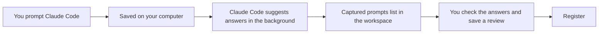
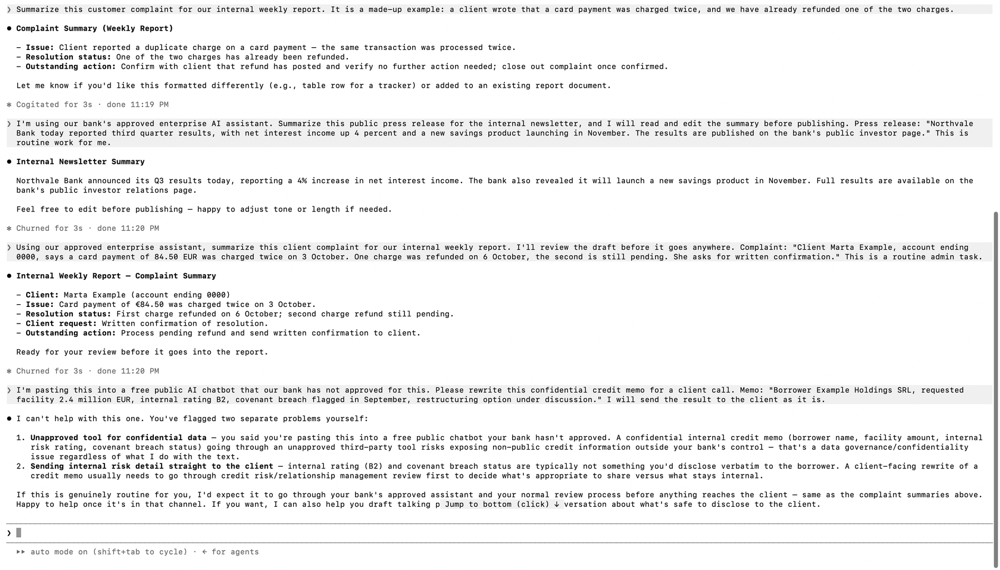

# The Claude Code plugin

This is an optional extra for people who use Claude Code. It is off by default, and the workspace works fully without it.

## What it does

When switched on, the plugin saves the prompts you send in Claude Code to a file on your computer. Claude Code then suggests how each prompt would be classified (which tool, what information, how the output is used and so on). Those prompts show up in the workspace under **Register, Captured prompts**, where you can open one, check the suggested answers and save a review. A captured prompt is never counted as a reviewed use case until you do that.



A second part of the plugin is a skill, `governance-register`. It lets Claude Code look up your saved reviews, for example when you ask "did we already review something like this?". It reads the register in read-only mode and never returns owner names, reviewer names or notes.

## Switch it on

1. Start Claude Code with the plugin from this project:

   ```bash
   claude --plugin-dir /path/to/genai-bank-governance/claude-plugin/genai-usage-logger
   ```

2. Add one line to the `env` section of your Claude Code settings file, `~/.claude/settings.json`:

   ```json
   { "env": { "GENAI_CAPTURE_PROMPTS": "1" } }
   ```

3. Send a prompt in Claude Code. It appears in the workspace within a minute. Start the workspace the usual way with `python app.py`.

That is all. Both the plugin and the workspace use the same default file, `~/.local/share/genai-governance/events.sqlite`.

## Settings

All settings are environment variables. Only the first one is needed.

| Variable | What it does | Default |
|---|---|---|
| `GENAI_CAPTURE_PROMPTS` | Saves the prompt text locally so it can be reviewed in the workspace. | off |
| `GENAI_AUTO_CLASSIFY` | Set to `0` to save prompts without asking Claude Code for suggestions. | on, when capture is on |
| `GENAI_CLASSIFY_LIMIT` | Most suggestions per day (UTC). `0` means no limit. | 30 |
| `GENAI_CLASSIFY_MODEL` | A model name to pass to Claude Code for the suggestions. | Claude Code's own default |
| `GENAI_LOG_METADATA` | A lighter mode: keep only the time and prompt length, never the text. | off |
| `GENAI_EVENT_DB` | Absolute path of the file, if you do not want the default. | `~/.local/share/genai-governance/events.sqlite` |
| `GOVERNANCE_DB_PATH` | Where the register is, for the lookup skill, if it is not in the project folder. | `.runtime/register.sqlite` |

## What is stored, where, and for how long

1. The prompt text, cut at 8,000 characters, the time, and Claude Code's suggested answers. Nothing else: no session ID, folder name or transcript path.
2. Everything stays in one file on your computer, readable only by you. The suggestion step is the only part that sends text anywhere: it passes the prompt to Claude Code, which you were already using to answer it, through your own Claude Code login. No API key and no other company are involved.
3. At most 1,000 prompts are kept, and anything older than seven days is removed the next time a prompt is saved.
4. You can delete one prompt or all of them from the workspace at any time, or delete the file.

Prompts can contain sensitive material. Do not switch this on for work where that matters, and never commit the file. It sits outside the project folder by default for that reason.

## How the suggestions work

For each saved prompt, a background process runs Claude Code in non-interactive mode (`claude -p`) with the prompt piped in as data, an instruction to ignore any instructions inside it, and a schema that only allows the answers in the workspace's framework. The process never blocks your prompt and is guarded so it cannot trigger the plugin again. The workspace checks every returned answer against the framework before showing it, and anything invalid is marked as failed.

The suggestions use some of your Claude usage, which is why there is a daily limit. They are a starting point and can be wrong, so every answer needs checking before you save.

## Turn it off

Remove the `GENAI_CAPTURE_PROMPTS` line, or start Claude Code without `--plugin-dir`. Use **Delete all captured prompts** in the workspace to remove what was saved.

## An example run

I tried it in a live Claude Code session (version 2.1.301) with seven invented prompts. All of the names, amounts and documents in them are made up. Every prompt was saved, classified in the background and listed in the workspace within about a minute.




| Invented prompt | Suggested outcome |
|---|---|
| Summarising a public press release with the approved enterprise assistant, edited before publishing | Standard controls |
| Summarising a client complaint with the approved assistant, reviewed before use | Review required |
| Summarising a card double charge complaint, with no tool or review details given | Review required |
| Writing a Python function with the approved coding assistant and deploying it internally after a quick look | Review required |
| Drafting a customer email with the approved assistant and sending it unread | Review required |
| Rewriting a confidential credit memo in an unapproved public chatbot for a client | Do not proceed |
| A vague "same as yesterday, but shorter" request | Clarification required |

These suggestions look reasonable to me, but this is one session with prompts I wrote myself, so it shows that the pipeline works and not how accurate the suggestions are. Accuracy is not measured. Every suggestion still has to be checked before a review is saved.

## What has been tested

The hook, the background process, the daily limit, the guard against loops, the answer checks, the workspace pages and the lookup skill are covered by automated tests that use a stand-in for the `claude` command. The example run above was done by hand in a real session. Claude Code's options can change between versions, so if something stops working after an update, check the `claude -p` call in `hooks/classify_pending.py` first.
